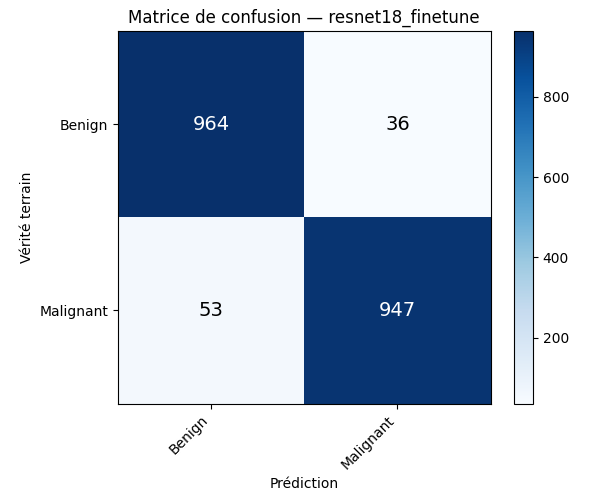

# Skin lesion classification: CNN vs ResNet18

An academic image-classification project comparing a small convolutional network with transfer learning on a binary **Benign / Malignant** dataset. The main result is a useful lesson in training choices: the fine-tuned ResNet18 did better on the dataset's provided evaluation folder, but its errors include malignant lesions predicted as benign. This is a coursework classifier, **not a clinically validated diagnostic tool**.

## My contribution

I built the dataset loader and custom CNN, then added exploration and training scripts, normalization and augmentation experiments, optimizer and learning-rate comparisons, ResNet18 training, error analysis, plots, and the presentation.

This repository contains the project's Python scripts and saved figures.

## Data and split

The project uses the [Melanoma Cancer Image Dataset on Kaggle](https://www.kaggle.com/datasets/bhaveshmittal/melanoma-cancer-dataset): 224 × 224 RGB lesion images in two class folders. I counted the images in the dataset used for the project:

| Folder | Benign | Malignant | Total |
| --- | ---: | ---: | ---: |
| `train/` | 6,289 | 5,590 | 11,879 |
| `test/` | 1,000 | 1,000 | 2,000 |

The code calls the provided `test/` folder **validation** and evaluates on it after every epoch. It was also used to compare configurations. There is no separate untouched test set, so the numbers below are evaluation-folder results, not an independent estimate of clinical or external performance.

## Models and training

| Model | Setup |
| --- | --- |
| Custom `SimpleCNN` | Three convolution + ReLU + max-pool blocks (16, 32, 64 channels), then a 256-unit dense layer and dropout `0.5`. Cross-entropy, Adam `1e-3`, batch size `32`, 20 epochs. |
| Normalized / augmented CNN | Channel statistics computed from `train/`; horizontal flip, ±10° rotation, brightness and contrast jitter on training images only. Separate scripts compare Adam learning rates, SGD, and StepLR. |
| ResNet18, frozen | ImageNet V1 weights; backbone frozen and a new two-class head trained with Adam `1e-3`. |
| ResNet18, fine-tuned | ImageNet V1 weights; `layer4` and the head trained with Adam at `1e-4` and `1e-3` respectively for 20 epochs. ImageNet normalization; no augmentation in this run. |

The scripts save the **final epoch** fine-tuned model. There is no seed setting, checkpoint selection procedure, repeated-run average, or recorded package versions. A rerun may differ.

## Results in the saved project artifacts

| Run | Evaluation-folder accuracy | Evidence |
| --- | ---: | --- |
| Custom CNN, no normalization | 91.4% | Figure reported in the [presentation source](presentation/presentation.tex) and shown in the [saved training curve](figures/courbes_cnn_simple.png); no checkpoint or log survives for an independent recalculation. |
| Custom CNN, train-set normalization | 93.3% | Presentation and [saved curve](figures/courbes_cnn_normalise.png); no checkpoint or log survives. |
| ResNet18, frozen backbone | 88.9% | Presentation and [saved ResNet curve](figures/courbes_resnet.png); no checkpoint or log survives. |
| ResNet18, fine-tuned `layer4` + head | **95.55% (1,911 / 2,000)** | Recalculated from the [saved confusion matrix](figures/matrice_confusion.png), which agrees with the presentation's rounded 95.6%. |

### Fine-tuned ResNet18 confusion matrix

Rows are the dataset label; columns are the model prediction. These four counts are visible in the saved matrix and sum to 2,000.

| Actual \ Predicted | Benign | Malignant |
| --- | ---: | ---: |
| Benign | 964 | 36 |
| Malignant | **53** | 947 |



The 53 malignant images called benign are the most consequential error type in this academic setup. The [saved error montage](figures/exemples_incorrects.png) shows the **first eight incorrect examples selected by `analyze.py`**; all eight are benign images predicted malignant, with displayed softmax scores from 0.68 to 1.00. They illustrate false positives, not the malignant false negatives. The high scores on errors are a reminder that softmax confidence is not clinical certainty.

## Reproduce the experiment

Use Python with a compatible PyTorch / torchvision installation. The scripts select CUDA when available and otherwise run on CPU. ResNet18 also downloads ImageNet weights on first use.

```bash
python3 -m venv .venv
source .venv/bin/activate
python -m pip install -r requirements.txt

# Download the Kaggle dataset archive and extract it so the layout is:
# melanoma-cancer-dataset/train/{Benign,Malignant}/*.jpg
# melanoma-cancer-dataset/test/{Benign,Malignant}/*.jpg
python verify_dataset.py

MPLBACKEND=Agg python train_simple.py
MPLBACKEND=Agg python train_normalized.py
MPLBACKEND=Agg python train_augmented.py
MPLBACKEND=Agg python train_resnet.py
MPLBACKEND=Agg python analyze.py
```

Run these from the repository root. The first three scripts are successive CNN experiments; `train_resnet.py` runs both the frozen and fine-tuned variants. `analyze.py` loads `checkpoint_resnet_ft.pth` if present, otherwise `checkpoint_aug.pth`, so check its printed model type before interpreting its output. The scripts write plots and checkpoints in the working directory; checkpoint files are ignored by Git. To reproduce **the saved numbers exactly**, the training checkpoint or full logs would be needed; neither is available here.

## Limits

- The `test/` folder was used during development, so these scores are not from a fresh, independent test set.
- Results may differ on images from other people, cameras, or clinics.
- This is a coursework model. It should not be used for diagnosis.
